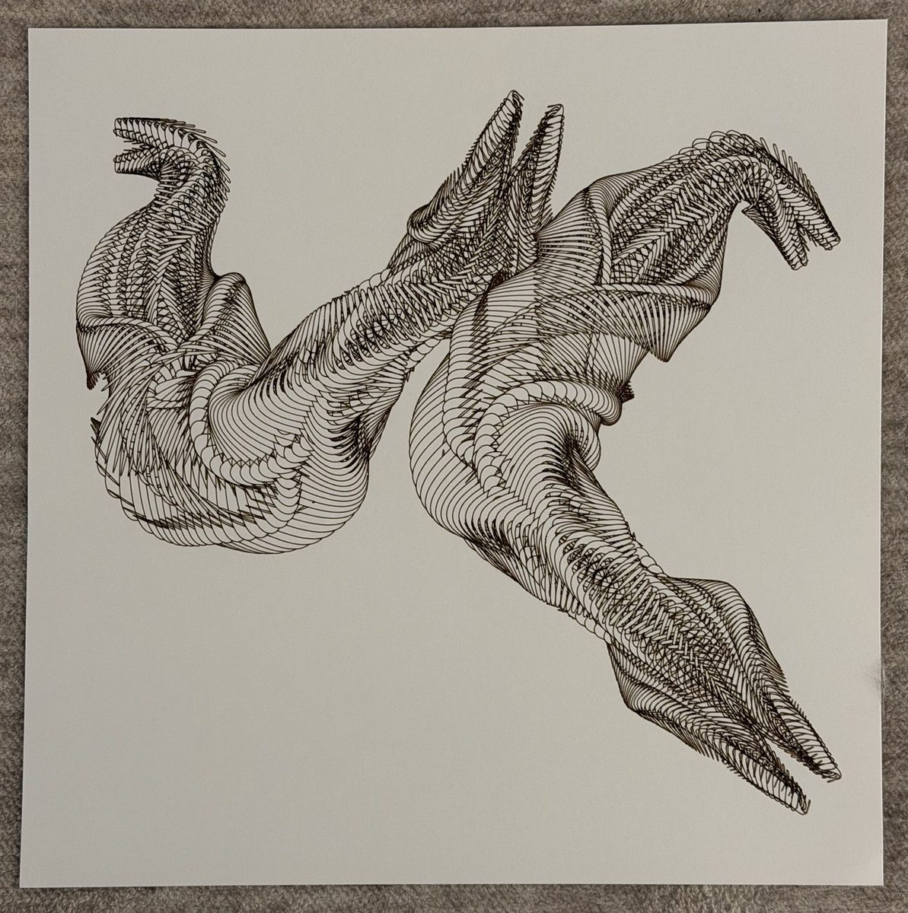
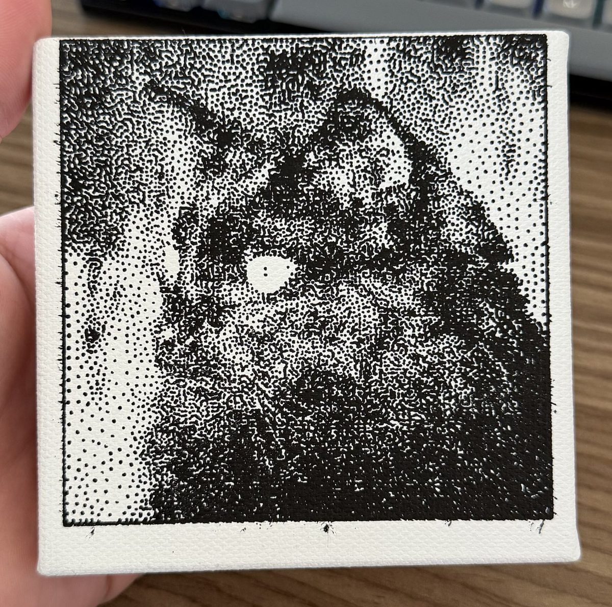
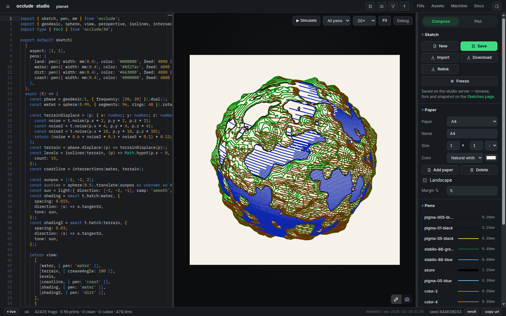
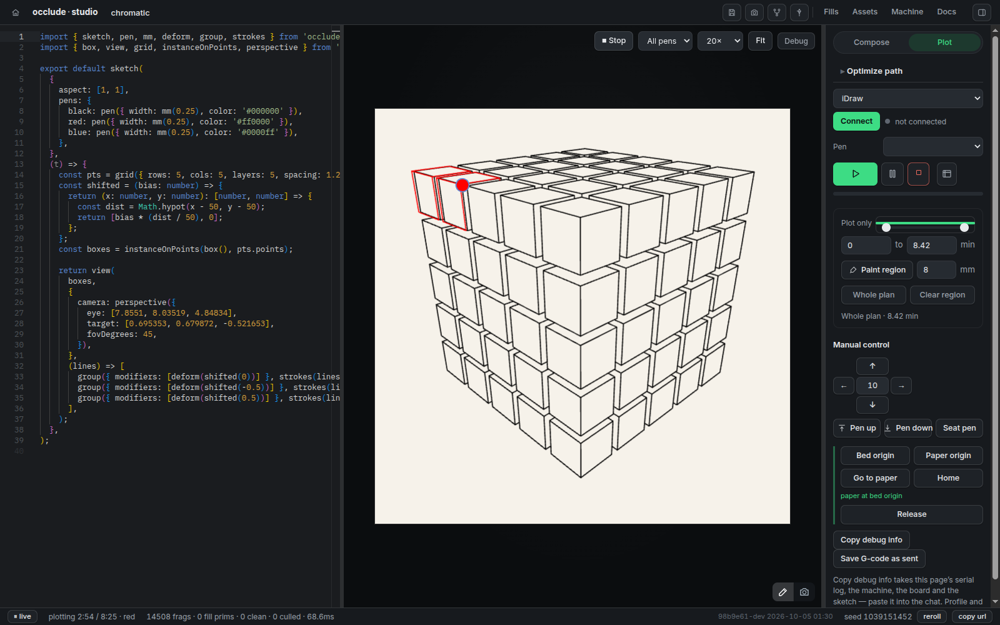
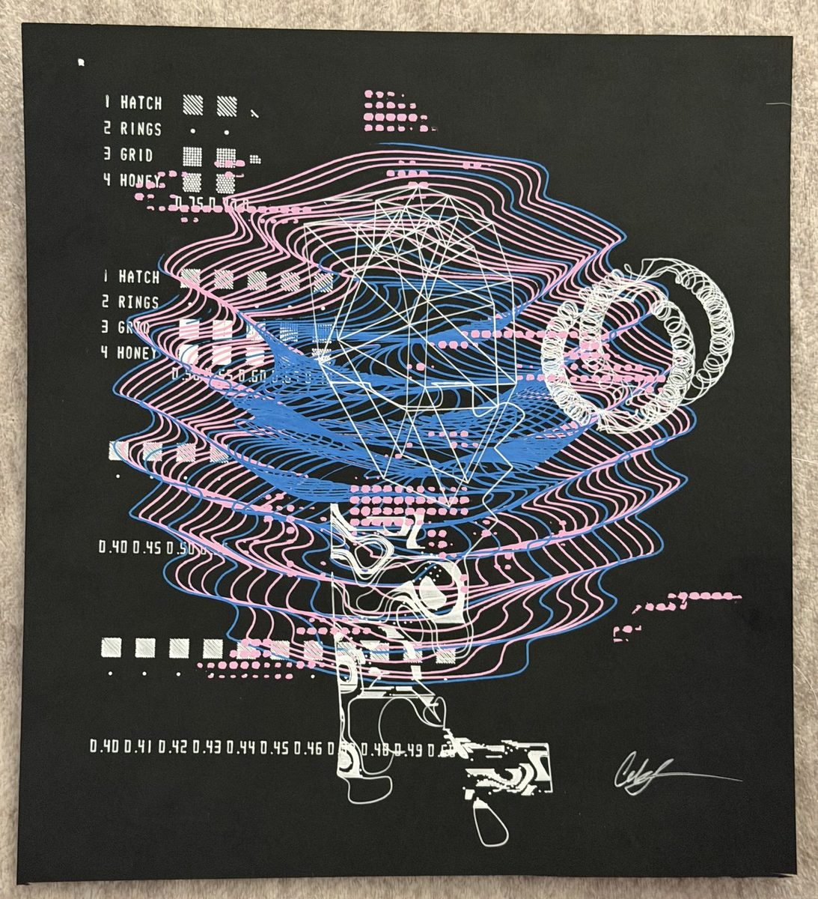

<p align="center">
  
</p>

<h1 align="center">occlude</h1>

<p align="center">Creative coding for pen plotters, where a shape can hide what is beneath it.</p>

<p align="center">
  
</p>

occlude is a TypeScript library and a browser studio for drawing with a pen plotter. You write a sketch; a Rust engine compiled to WebAssembly works out exactly which strokes stay visible where shapes overlap, plans the pen's route, and drives the machine. The preview is drawn at nib width, so what you see is what the plotter draws.

```ts
import { sketch, circle, line, fill, mm } from 'occlude';

export default sketch({ aspect: 'square', margin: 8, seed: 42 }, (t) => [
  t.times(24, (_, u) => line(0, u * 100, 100, u * 100)),
  t.times(12, () => circle(t.rnd(18, 82), t.rnd(18, 82), t.rnd(6, 18), {
    fill: fill('contour', { spacing: mm(1.1) }),
  })),
]);
```

The discs hide the lines drawn before them, and each contour fill follows the part of its disc that is still exposed. Coordinates are percentages of the drawable's shorter side; `mm()` is for physical lengths such as fill spacing. The same sketch and seed always give the same ink.

## What's in it

- **Exact occlusion.** A filled shape, or one marked `opaque: true`, hides the ink beneath it; `mask(shape)` hides without drawing. Visibility is solved on lines, arcs and cubics, not on a pixel mask.
- **Fills.** Hatch, crosshatch, stipple, solid rulings, contour fills built from a Voronoi distance field, and fills you write yourself.
- **Geometry you can hold.** Points, edges and faces with named columns: scatter and settle points, cut Voronoi cells and tilings, thicken paths, grow structures with rewrite rules and forces, and trace fields with isolines and streamlines.
- **3D line art.** `occlude/3d` builds meshes from primitives, OBJ files, sweeps and displacement; `view` projects them through a camera with exact hidden-line removal, silhouettes, creases and surface hatching.
- **Images and type.** Sample a photo's tone, direction or colour to place your own marks, import SVG, and set text in bundled single-line Hershey and Relief fonts.
- **Line character.** Smooth, roughen and deform geometry before visibility; dash, decimate and wobble the ink after it. A stroke shader runs along every stroke of the plan.

<p align="center">
  
</p>

## The studio

<p align="center">
  
</p>

A code editor beside a live preview. Sketches, pens, papers and machine profiles are kept in a library on the studio server, with forks and seeded snapshots.

<p align="center">
  
</p>

The Plot panel simulates the plot against its time estimate, then drives the machine over Web Serial (Chrome or Edge): EBB boards such as the AxiDraw and iDraw, and GRBL controllers such as the iDraw H. The Export panel writes SVG and PNG of the drawing, and G-code per pen.

## Run it

You need Node 24, pnpm 10, Rust through rustup (`rust-toolchain.toml` pins the version) and [wasm-pack](https://rustwasm.github.io/wasm-pack/).

```sh
git clone https://github.com/Kalmarv/occlude.git
cd occlude
pnpm run build:wasm    # build the engine before installing
pnpm install
pnpm --filter occlude-studio dev    # http://localhost:5173
```

`pnpm build` then `pnpm --filter occlude-studio serve` runs the production studio on port 4173, with the docs site at `/docs`. `pnpm docker:build && pnpm docker:up` does the same from the pinned toolchain, and fails the build if any check fails.

Without a browser (sketch paths are relative to `packages/occlude`, or absolute):

```sh
pnpm --filter occlude render sketch.ts --seed 7 --paper A4 --out out.png   # PNG and SVG
pnpm --filter occlude plotstats sketch.ts --seed 7    # ink length, travel, plot time
pnpm --filter occlude freeze sketch.ts --seed 7       # render in node, hand the studio a plottable result
```

## Docs

- [Reference](docs/reference): one entry for each word, with its signature, a paragraph and a live example.
- [Examples](docs/examples): one page for each drawing, with the whole sketch.
- [Architecture](docs/architecture.md), [device notes](docs/device-notes.md) and [working notes](docs/notes.md), for working on occlude itself.

`pnpm check` is the full gate: Rust and TypeScript tests, typechecks, every live docs example rendered and compared against its saved ink, the production build, the bundled WebAssembly matching the engine's build byte for byte, and two smoke tests.

<p align="center">
  
</p>

## Credits & prior art

Occlude implements its own engine, but it stands on published work and
open projects. Where a license is copyleft, we used **ideas, protocol
facts, and papers — never code**:

| Project / work | What we took | License |
|---|---|---|
| [saxi](https://github.com/alexrudd2/saxi) | EBB `LM` rate math conventions (steps·2³¹/25kHz, ΔR derivation) verified against its source; formulas are EBB protocol facts. No code. | AGPL-3.0 |
| [EBB / EggBot](https://github.com/evil-mad/EggBot) (Evil Mad Scientist, Brian Schmalz) | The EBB command set our Web Serial driver speaks, via its protocol documentation. No code. | GPL-3.0 |
| [Marlin](https://github.com/MarlinFirmware/Marlin) & [Klipper](https://github.com/Klipper3d/klipper) | Motion-planning concepts: junction deviation, minimum cruise ratio, look-ahead structure. Ideas only. | GPL-3.0 |
| Deussen, Spicker et al., *Weighted Linde-Buzo-Gray Stippling* (SIGGRAPH Asia 2017); [reference impl](https://github.com/MarcSpicker/LindeBuzoGrayStippling) | `t.settle(t.scatter(...))` implements the paper's algorithm from the paper. No code from the LGPL reference. | paper / LGPL-3.0 |
| [Stanford Bunny](http://graphics.stanford.edu/data/3Dscanrep/) (Turk & Levoy, SIGGRAPH 1994) | The range-scan mesh as a test fixture for the OBJ import (`test/fixtures/stanford-bunny.obj`, the MeshLab OBJ from [common-3d-test-models](https://github.com/alecjacobson/common-3d-test-models)). Data only. | Stanford Computer Graphics Laboratory; free with acknowledgement |
| Dr. A. V. Hershey (U. S. National Bureau of Standards), packed for Usenet by James Hurt (Cognition, Inc.); [hershey-fonts](https://github.com/kamalmostafa/hershey-fonts) | The five bundled `.jhf` faces in `occlude/fonts` (roman simplex/duplex/triplex, script simplex, gothic english), verbatim data with the distribution notice kept beside them (`src/fonts/HERSHEY-NOTICE.txt`). Data only; no line of the GPL Inkscape Hershey Text extension. | public domain, with the distribution's two acknowledgements |
| [Relief SingleLine](https://github.com/isdat-type/Relief-SingleLine) (isdaT, François Chastanet and students) | The `relief` face in `occlude/fonts`: `ReliefSingleLineSVG-Regular.svg` verbatim, licence beside it (`src/fonts/RELIEF-LICENSE.txt`). Reserved Font Name "Relief SingleLine". Data only. | OFL-1.1 |
| Bridson, *Fast Poisson Disk Sampling* (2007) | `scatter` and the stipple fill's blue-noise placement. | paper |
| Jobard & Lefer, *Creating Evenly-Spaced Streamlines of Arbitrary Density* (Eurographics 1997) | `t.streamlines` implements the paper's seeding and separation scheme, with the spacing as a field. Ideas from the paper only. | paper |
| [Boost Voronoi](https://docs.rs/boostvoronoi/0.12.1/boostvoronoi/) | Pinned Rust point/segment Voronoi dependency for analytic distance contours and vector residual cleanup. | BSL-1.0 |
| [Cavalier Contours](https://github.com/jbuckmccready/cavalier_contours) | Pinned Rust dependency for line/arc region offsets in native contour fill. | MIT / Apache-2.0 |
| [robust](https://github.com/georust/robust) | Adaptive orientation predicates for native contour cleanup partition validation. | MIT / Apache-2.0 |
| [Earcut](https://github.com/georust/earcut) | Triangulation of native contour-fill cleanup regions. | MIT / Apache-2.0; upstream Mapbox portions ISC |
| [Blender](https://projects.blender.org/blender/blender/src/tag/v5.2.1) | Development-only Line Art vector reference fixtures and documented feature/selection concepts. Prebuilt 5.2.1 LTS; no engine code copied or runtime dependency. | GPL; Line Art source GPL-2.0-or-later |
| [CGAL](https://www.cgal.org/) | Independent, development-only conic-arrangement reference for `thicken`; not bundled or linked into the library. | Package-specific GPL/LGPL; external test dependency |
| [Javascript Clipper](https://github.com/junmer/clipper-lib) | Integer polygon union for bounded TypeScript `thicken()` | Boost Software License 1.0 (bundled JSBN: BSD) |
| [iOverlay](https://github.com/iShape-Rust/iOverlay) | Pinned Rust dependency for winding normalization, visible-area Booleans, nib sweeps and polygon offset recovery. | MIT / Apache-2.0 |
| [d3-delaunay](https://github.com/d3/d3-delaunay) (Mike Bostock) | Bundled dependency powering `voronoi`/`triangulate`/`settle`; his weighted-stippling notebook showed the `delaunay.find` accumulation walk. | ISC |
| [robust-predicates](https://github.com/mourner/robust-predicates) (Vladimir Agafonkin, after Shewchuk) | Bundled dependency: exact `orient2d`/`orient3d` predicates for 2D crossing/contact and 3D triangulation/visibility refinement. | Unlicense (public domain) |
| [commons-math-interpolation](https://github.com/chdh/commons-math-interpolation) (Christian d'Heureuse) | Bundled dependency: the Akima / cubic / linear interpolators behind `shaper()`. | MIT |
| [plotterbench](https://github.com/plotterbench) | Inverse-kinematics golden-test idea (backlog). Ideas only — PolyForm forbids code reuse. | PolyForm Shield |
| Robert Penner / [easings.net](https://easings.net) | The `ease.*` curve catalog (standard formulas). | formulas |
| [p5.js](https://p5js.org), [vpype](https://github.com/abey79/vpype) | API ergonomics and plotter-workflow inspiration, respectively. | — |
